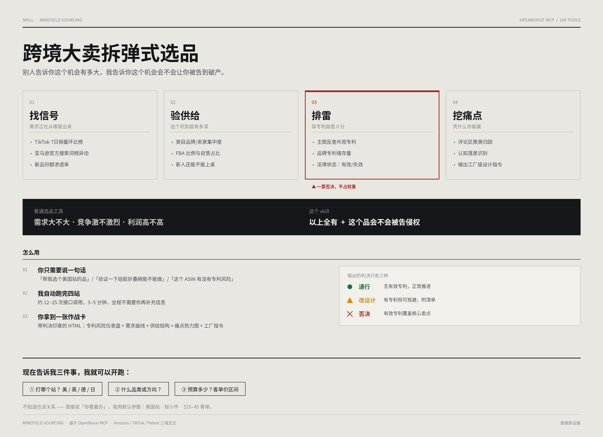

# 跨境大卖拆弹式选品 / Minefield Sourcing

[](https://claude.com)
[](https://mcp.openboostai.com)
[](LICENSE)



一个基于 [OpenBoost MCP](https://mcp.openboostai.com) 的跨境电商选品 skill。核心差异：**把专利风险做成选品的准入闸门，而不是事后审查。**

---

## 为什么做这个

市面上的选品工具都在回答同一个问题：**这个机会有多大。**

几乎没人回答第二个问题：**这个机会会不会让你被告到倾家荡产。**

一个类目月销百万美金、竞争度低、利润率高、数据漂亮得像教科书 —— 而你备货三十万发到海外仓之后，收到一封外观专利侵权律师函，链接被下架、库存被销毁、账户资金被冻结。这不是运气差，是选品流程里缺了「专利」这一环。

这个 skill 把专利从「事后审查」提前到「选品第一关」，并且**用商品主图直接反查外观专利** —— 不需要专利号，不需要律师，4 秒出结果。

> **核心原则：专利不是加减分项，是一票否决项。**
> 一个 95 分的机会如果踩在有效专利上，它的分数是 0，不是 95。

---

## 四站流水线

```
┌─────────┐   ┌─────────┐   ┌─────────┐   ┌─────────┐
│01 找信号 │ → │02 验供给 │ → │03 排雷  │ → │04 挖痛点 │
│需求从哪来│   │坑有多深  │   │★ 闸门   │   │凭什么你赢│
└─────────┘   └─────────┘   └─────────┘   └─────────┘
```

| 站点 | 做什么 | 用到的接口 |
|---|---|---|
| **01 找信号** | TikTok 销量环比找暴增品 + 亚马逊 ABA 搜索词榜找排名异动，锁定「增速和竞争还没对齐」的时间差 | `tt_commodity_info_list` `amz_aba_research_weekly` `amz_aba_research_trends` |
| **02 验供给** | 品牌/卖家集中度、FBA 比例、新品份额渗透 —— 判断新人还能不能上桌 | `amz_market_research` `amz_product_selection` |
| **03 排雷 ★** | 商品主图反查外观专利 → 查品牌专利墙 → **查法律状态（失效的可自由抄）** | `patent_image_search_single` `patent_query_search` `patent_semantic_search` `patent_legal_status` `patent_family` |
| **04 挖痛点** | 评论聚类找「认知落差」，输出工厂能直接执行的设计指令 | `tt_commodity_voice_analyze` `amz_review_query` |

四项打分（需求 25% / 供给 25% / 利润 20% / 差异化 30%），**专利不占权重，它是闸门**。最终输出一份 HTML 作战卡。

---

## 快速开始

### 1. 装 skill

把 `minefield-sourcing/` 整个目录放到你的 skills 目录，或把打包好的 `.skill` 拖进 Claude 桌面 App。

### 2. 配 MCP

```json
{
  "mcpServers": {
    "openboost": {
      "type": "streamable-http",
      "url": "https://mcp.openboostai.com/mcp-servers/openboost-all-mcp",
      "headers": { "secret-key": "<你自己的 key>" }
    }
  }
}
```

> **你需要自己的 OpenBoost 账号。** 额度按调用次数计费，单次完整流程约 12–25 次调用。

### 3. 用

```
帮我选个美国站的家居品，客单 20 美金左右
```

或者直接给具体商品做专利排雷：

```
这个 ASIN 有没有专利风险：B07YB1ZXG6
```

首次调用会先展示引导图，然后问你三个条件（站点、品类、预算）。

---

## 案例：纳米双面胶带

完整作战卡：**[在线预览](https://zarockfat.github.io/minefield-sourcing-zgg/)** · [源码](minefield-sourcing/examples/battlecard-nano-tape.html)，数据全部来自接口实时返回（2026-11-09）。

> GitHub 只渲染 Markdown、不渲染 HTML，直接点 `.html` 文件看到的是源码。在线预览是渲染后的页面。

| 站点 | 关键发现 |
|---|---|
| 信号 | TikTok 7 天 3,915 单，**带货达人数 0、视频数 0、评论数 0** —— 纯自然流量起势 |
| 需求 | ABA `double sided tape` 周搜 139,262，Top3 点击集中度 30.3%（健康），但 4 周趋势向下 |
| 供给 | 46 品牌 / 41 卖家，FBA 68%，自营 24%；SUTOUG 2025-09 上架，13 个月做到 30 日 1.6 万单 |
| **专利** | 主图反查命中 4 件美国外观专利，**3 件有效**、1 件失效；头部三家品牌存量仅 0–2 件 |
| 痛点 | **39% 好评夸「强力粘合」 vs 36% 差评骂「粘合强度低」** —— 同一产品评价两极 |

**判决：67 分 / 🟡 改设计后推进。** 3 件有效专利都指向「胶带卷」的载体形态而非核心功能，可规避。

最有价值的一步是痛点：39% 和 36% 的撕裂说明**用户在没有被告知的边界外使用它**。所以这个品类的赢法不是「做得更粘」，是把使用边界讲清楚。

---

## 实测踩到的坑

这些是写这个 skill 的过程中真实踩出来的，已全部写进 SKILL.md 的规避说明。**其中前 3 条可能是 OpenBoost 接口层面值得优化的点。**

### 1. 专利图像检索必须配 `query_text`，否则伪命中率极高

Gaiam 瑜伽垫主图不加过滤时，Top1 命中是「Flexible sheet metal 柔性金属板」（评分 0.595），命中总数 **24,150 条**。加 `query_text: "TACD:(yoga mat)"` 后降到 **17 条**且全部相关。

### 2. 检索词必须用专利术语，不是电商营销词

`TACD:(nano tape)` → **0 条**。因为 "nano tape" 是电商叫法，专利文献写的是 `adhesive tape`。同一张图换 `TACD:(adhesive tape)` → 47 条。

> ⚠️ **0 命中很容易被误读成「无专利风险」，实际是查错了。** 这是整个流程最容易造成误判的地方。

| 电商叫法 | 专利检索词 |
|---|---|
| nano tape / 纳米胶 | adhesive tape |
| shapewear / 塑身衣 | body shaper / undergarment |
| yoga mat | exercise mat |
| tummy control | girdle / corset |
| water bottle | beverage container |
| pet hair remover | lint roller |
| phone holder | support bracket |

### 3. `amz_product_selection` 的 `matchType` 默认值会跑偏

默认 2（模糊子串）时，传 `keyword: "nano tape,double sided tape heavy duty"` 返回的全是**牙膏**（Boka 品牌）。显式传 `matchType: 1`（词组匹配）后才正确返回胶带卖家。

### 4. 两个专利接口返回 markdown 包装

`patent_legal_status` / `patent_semantic_search` 返回的是「字段说明 markdown + 末尾内嵌原始 JSON」，而其他接口返回两层序列化的 JSON 字符串。解析方式不统一。

### 5. `nodeIdPath` 匹配行为不一致

`amz_market_research` 是前缀模糊匹配；`amz_market_seller_location` 要求精确相等，传父类目 ID 返回空数组。

### 其他参数规律

- `webSiteId` 必须传数字字符串（`"1"`），传 `"US"` 报 `PARAM_ERROR`
- `amz_sku_query` 的 ASIN 参数名是 `skuId`，不是 `asin`
- `amz_aba_research_weekly` 的 `ds` 传查询周的**周六**日期
- `tt_*` 系列 `countryRegion` 传中文（`"美国"`）
- 分页上限：TikTok `size` ≤30（口碑分析 ≤10），ABA ≤15，AMZ 评论 ≤10
- 用月销筛选（`minUnits` 等）必须同时传 `month`

---

## 目录结构

```
minefield-sourcing/
├── SKILL.md                    # 主指令
├── assets/
│   ├── intro.png               # 首次调用展示的引导图
│   └── openboost_mcp.py        # 无原生 MCP 接入时的直连脚本
├── references/
│   ├── toolbook.md             # 用到的接口参数手册
│   └── battlecard-spec.md      # 作战卡视觉与写作规格
└── examples/
    └── battlecard-nano-tape.html
```

---

## 免责声明

**这个 skill 不能替代律师。** 专利检索只能降低风险，不能消除风险。命中结果需要人工复核；正式投产前建议做一次正式的 FTO（自由实施）检索。专利数据存在地域、时效、翻译等局限。

选品决策请自行判断，作者不对任何商业损失负责。

---

## License

MIT
